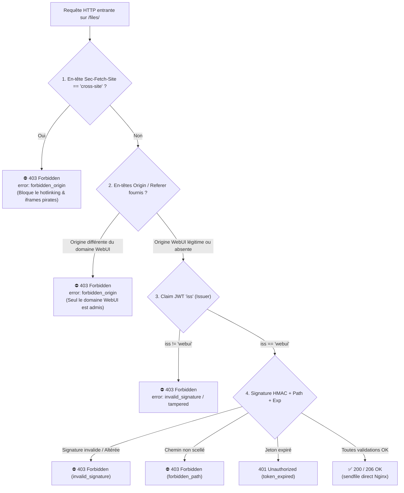

# Sécurité de Fileserver en Production (`PROD_SECURITY.md`)

Ce document formalise l'architecture de sécurité, la défense en profondeur et les mécanismes de contrôle d'accès implémentés dans **Fileserver** (`packages/fileserver`), en particulier lors de l'exécution en mode production (`KB_ENV=production`).

---

## 1. Vue d'Ensemble : Comportement Dev vs Production

Fileserver repose sur un moteur NGINX combiné au runtime `njs` (`njs/explorer.js`). Son comportement bascule selon la variable `KB_ENV` :

```mermaid
flowchart TD
    Req["Requête HTTP arrivant sur Fileserver"] --> CheckEnv{"KB_ENV == 'production' ?"}
    
    %% Branche Dev
    CheckEnv -->|Dev| DevUI{"Endpoint demandé ?"}
    DevUI -->|GET /| BasicAuth{"Challenge HTTP Basic Auth<br>(FILESERVER_DEV_USER / FILESERVER_DEV_PASSWORD)"}
    BasicAuth -->|Non authentifié| E401Basic["401 Unauthorized<br>WWW-Authenticate: Basic"]
    BasicAuth -->|Identifiants valides (dev/dev ou env)| Cookie["Émission Cookie fs_ui_session<br>(generateUiCookie) + 200 index.html"]
    DevUI -->|/api/list ou /api/zip| CheckCookie{"Cookie UI ou Basic Auth valide ?"}
    CheckCookie -->|Oui| AllowUI["200 OK : Exploration & ZIP autorisés"]
    DevUI -->|/files/...| CheckDevJWT["Token JWT ou Cookie UI ou Basic Auth"]
    CheckDevJWT -->|Valide| SendDev["200/206 sendfile"]

    %% Branche Production
    CheckEnv -->|Production| ProdCheck{"Endpoint demandé ?"}
    ProdCheck -->|"GET / (UI Explorer)"| BlockRoot["⛔ 403 Forbidden<br>ui_disabled_in_production<br>(Dev credentials strictement ignorés)"]
    ProdCheck -->|"/api/list ou /api/zip"| BlockUI["⛔ 403 Forbidden<br>ui_session_required<br>(isUiRequest = false)"]
    ProdCheck -->|"/files/... (Fichiers bruts)"| CheckOrigin{"1. Contrôle Provenance WebUI<br>(Origin / Referer / FetchSite)"}
    CheckOrigin -->|Sec-Fetch-Site cross-site ou Origine inconnue| E403Orig["⛔ 403 Forbidden<br>(forbidden_origin)"]
    CheckOrigin -->|Origine WebUI légitime ou absente| ProdJWT{"2. Validation Cryptographique JWT"}
    ProdJWT -->|Absence de token| E401["401 Unauthorized (missing_token)"]
    ProdJWT -->|Token expiré| E401Exp["401 Unauthorized (token_expired)"]
    ProdJWT -->|Signature invalide / Falsification| E403["403 Forbidden (invalid_signature)"]
    ProdJWT -->|Chemin différent du claim path| E403Path["403 Forbidden (forbidden_path)"]
    ProdJWT -->|Issuer différent de 'webui'| E403Iss["403 Forbidden (invalid_signature / tampered)"]
    ProdJWT -->|Valide + Chemin exact + iss:webui| Stream["✅ 200 / 206 OK<br>(sendfile direct Nginx)"]
```

---

## 2. Défense en Profondeur sur `/files/...` (JWT + Provenance WebUI)

Même si un jeton d'accès temporaire était intercepté ou copié dans une URL, une série de barrières successives empêche son utilisation en dehors du contexte WebUI officiel :



---

## 3. Détail des 4 Barrières de Sécurité

### Barrière 1 : Protection Anti-Hotlinking & Anti-CSRF (`Sec-Fetch-Site`)
* **Mécanisme :** Le navigateur transmet automatiquement l'en-tête de métadonnées `Sec-Fetch-Site`.
* **Règle :** Toute requête marquée `Sec-Fetch-Site: cross-site` (par exemple un site pirate intégrant un PDF dans un iframe ou une balise `/<embed>`) est **immédiatement rejetée avec HTTP 403 Forbidden (`forbidden_origin`)**, avant même toute vérification cryptographique.

### Barrière 2 : Filtrage Strict d'Origine (`Origin` & `Referer`)
* **Mécanisme :** NGINX extrait l'hôte de l'en-tête `Origin` ou `Referer` transmis par le navigateur.
* **Règle :** L'hôte doit correspondre au domaine de WebUI (déduit de `ALLOWED_HOSTS` ou de la racine `files.*`).
* **Exemple :**
  - Si Fileserver écoute sur `files.kb.company.com` avec `ALLOWED_HOSTS=files.kb.company.com,files.*` :
  - `Origin: https://kb.company.com` $\rightarrow$ **AUTORISÉ**.
  - `Origin: https://evil-attacker.com` $\rightarrow$ **REJETÉ (HTTP 403 forbidden_origin)**.

### Barrière 3 : Scellement de l'Émetteur (`iss: "webui"`) et de l'Audience (`aud: "fileserver"`)
* **Mécanisme :** Les jetons créés par `packages/webui/src/backend/source-files/jwt.ts` incluent systématiquement les claims `iss: "webui"` et `aud: "fileserver"`.
* **Règle :** Tout jeton dont le claim `iss` est différent de `'webui'` ou dont le claim `aud` est différent de `'fileserver'` est immédiatement rejeté en tant que jeton falsifié (`tampered` $\rightarrow$ HTTP 403). Cela garantit qu'aucun autre jeton interne émis par WebUI ne puisse être rejoué sur Fileserver.

### Barrière 4 : Cryptographie HMAC-SHA256 (RFC 7519)
* **Secret Partagé Fort :** Seul le backend WebUI détient `FILESERVER_JWT_SECRET`.
* **Scellement du Chemin (`path`) :** Le jeton n'est valide que pour le chemin exact demandé (ou sous-arborescence autorisée). Obtenir un jeton pour `rapport.pdf` ne permet jamais d'accéder à `autre.pdf`.
* **Expiration Courte (`exp`) :** Par défaut 30 minutes, avec renouvellement transparent par le backend WebUI pour les sessions actives.

---

### Barrière 5 : Protection Anti-DDoS, CSP Sandbox & Audit Infalsifiable
* **Limitation des connexions et débits (`limit_conn` & `limit_req`) :**
  - Sur `/files/` : `limit_conn file_conns 10` (max 10 téléchargements simultanés par IP) et `limit_req zone=files_requests burst=20 nodelay` (10 req/s). Évite la saturation des I/O disques et des workers NGINX.
  - Sur `GET /` (Dev Basic Auth) : `limit_req zone=dev_login_req burst=10 nodelay` (5 req/s) pour parer toute attaque par force brute sur les identifiants dev.
* **En-têtes CSP Sandbox & Isolation Contenu (Anti-XSS)** :
  - Sur `/files/` : `Content-Security-Policy: default-src 'none'; sandbox; frame-ancestors 'self';` et `Permissions-Policy: camera=(), microphone=(), geolocation=()`. Tout fichier SVG, HTML ou XML injecté dans le corpus est ainsi exécuté dans une sandbox totale sans possibilité d'accès aux cookies ou à l'API du navigateur.
* **Audit Trail Infalsifiable (`$verified_user`)** :
  - L'identité utilisateur enregistrée dans les logs d'accès JSON est extraite directement du claim `sub` du token JWT vérifié par `njs`, neutralisant toute tentative d'usurpation via des en-têtes HTTP arbitraires.
* **Confinement Conteneur (Moindre Privilège)** :
  - Système de fichiers racine en lecture seule (`read_only: true`), interdiction d'élévation de privilèges (`no-new-privileges: true`), et suppression intégrale des capacités Linux non requises (`cap_drop: [ALL]`, seules `CHOWN`, `SETUID`, `SETGID`, `NET_BIND_SERVICE` sont conservées pour NGINX).
  - Segmentation réseau en production : Fileserver est confiné dans `frontend-net`, isolé de PostgreSQL et des bases de données internes.

---

## 4. Matrice des Statuts HTTP & Réponses JSON

| Situation / Cause | Statut HTTP | En-têtes Reçus | Corps de Réponse JSON |
| :--- | :--- | :--- | :--- |
| **Requête Cross-site ou Origine Pirate** | `403 Forbidden` | `Content-Type: application/json` | `{"error":"forbidden_origin"}` |
| **Tentative d'accès à `/api/list` ou `/api/zip` en Prod** | `403 Forbidden` | `Content-Type: application/json` | `{"error":"ui_session_required"}` |
| **Signature altérée ou mauvais secret** | `403 Forbidden` | `Content-Type: application/json` | `{"error":"invalid_signature"}` |
| **Chemin demandé différent du jeton** | `403 Forbidden` | `Content-Type: application/json` | `{"error":"forbidden_path"}` |
| **Absence de jeton sur `/files/...`** | `401 Unauthorized` | `WWW-Authenticate: Bearer error="missing_token"` | `{"error":"missing_token"}` |
| **Jeton expiré (signature valide)** | `401 Unauthorized` | `WWW-Authenticate: Bearer error="token_expired"`<br>`X-Token-Status: expired` | `{"error":"token_expired"}` |
| **En-tête `Host:` non autorisé** | `400 Bad Request` | — | Code Nginx 400 |
| **Validation complète réussie** | `200 OK` / `206 Partial Content` | `Cache-Control: private, no-cache`<br>`ETag`, `Accept-Ranges: bytes` | Flux binaire optimisé Nginx (`sendfile`) |

---

## 5. Configuration Recommandée en Production (`.env.prod`)

```bash
# Activation du mode production (UI désactivée, vérifications strictes)
KB_ENV=production

# Secret HMAC fort généré aléatoirement (openssl rand -base64 48)
FILESERVER_JWT_SECRET=mN5bV7cX9zL1kI3jH5gF7dD9sA1qW3eR5tY7uI9oP1lK3jH5gF7dD9sA1qW3eR5tY
FILESERVER_UI_SECRET=x9k8Bv2LpQ4mRtY7wE1uI3oP5aS6dF8gH0jK2lZ4xV6B8nQ1wE3rT5yU7iO9pL2kM4

# Noms de domaine autorisés (Le joker seul '*' est strictement interdit)
# Convention : préfixe files.* calqué sur le domaine WebUI
FILESERVER_ALLOWED_HOSTS=files.kb.company.com,files.*

# Montage volume : LECTURE SEULE OBLIGATOIRE
# Le conteneur refuse de démarrer si /srv/data est monté en écriture !
```

### Variables de Développement & Comportement en Production

| Variable | Environnement Dev (`KB_ENV=dev`) | Environnement Production (`KB_ENV=production`) |
| :--- | :--- | :--- |
| `FILESERVER_DEV_USER` | Identifiant HTTP Basic Auth sur `GET /` (défaut : `dev`). | **Ignoré** — `[STARTUP WARNING]` émis si défini. |
| `FILESERVER_DEV_PASSWORD` | Mot de passe HTTP Basic Auth sur `GET /` (défaut : `dev`). | **Ignoré** — `[STARTUP WARNING]` émis si défini. |

> [!WARNING]
> En mode production, l'UI explorateur est **totalement désactivée** (`GET /` renvoie HTTP 403 `ui_disabled_in_production`).
> Si `FILESERVER_DEV_USER` ou `FILESERVER_DEV_PASSWORD` est détecté dans l'environnement lors du démarrage du conteneur, `entrypoint.sh` émet un avertissement explicite sur `stderr` :
> ```text
> [STARTUP WARNING] [PROD MODE] FILESERVER_DEV_USER / FILESERVER_DEV_PASSWORD sont définis mais sont strictement ignorés en production (l'UI explorateur est désactivée).
> ```
> Cela évite qu'un administrateur pense à tort que l'interface explorateur est sécurisée par Basic Auth en production alors qu'elle est désactivée au profit du seul accès programmatique `/files/...` scellé par JWT.

---

## 6. Commandes de Validation Rapide

```bash
# 1. Vérifier que l'énumération (/api/list) est neutralisée (Attendu: 403 Forbidden) :
curl -i -H "Host: files.kb.company.com" http://127.0.0.1:8080/api/list

# 2. Vérifier le rejet d'une origine pirate (Attendu: 403 Forbidden) :
curl -i -H "Host: files.kb.company.com" -H "Origin: https://evil.com" \
  "http://127.0.0.1:8080/files/doc.pdf?token=TOKEN_VALIDE"

# 3. Vérifier le rejet d'un téléchargement sans jeton (Attendu: 401 Unauthorized) :
curl -i -H "Host: files.kb.company.com" http://127.0.0.1:8080/files/doc.pdf
```
