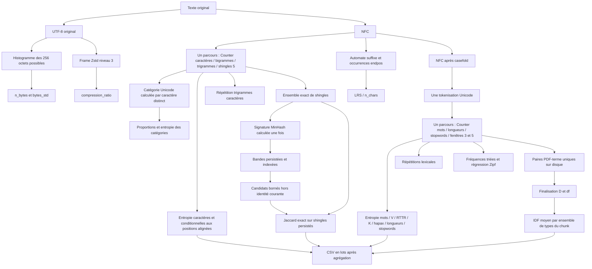

# Audit statistique des chunks en cache

`pdfparse-cachecheck` écrit les **35 colonnes demandées**, dans leur ordre exact,
sur stdout. Le total annoncé initialement était 34, mais la liste comporte 35
champs ; les 35 ont été conservés avec accord de l’utilisateur. Aucun score de
qualité composite n’est inventé. Ces descripteurs mesurent des propriétés
statistiques, pas la véracité ou l’utilité sémantique d’un texte.

```bash
pdfparse-cachecheck --data-dir /data > chunks.csv
pdfparse-cachecheck --data-dir /data --configuration profil.json --workers 4 --batch-size 128 > chunks.csv
# Même DATA_DIR exporté ou .env racine que pdfparse-run :
pdfparse-cachecheck > chunks.csv
# Conteneur déjà lancé, depuis la racine du dépôt :
bash packages/pdfparse/scripts/check-cache-in-compose.sh --workers 4 > chunks.csv
# API d’entrée indépendante des caches, une ligne JSON par chunk :
pdfparse-cachecheck --input-jsonl chunks.jsonl > chunks.csv
```

Le profil par défaut est **le profil compact partagé avec `pdfparse-run`**. La
configuration personnalisée utilise le même JSON `RuntimeConfiguration`.
Le CLI lit `index.jsonl` **ligne par ligne**, sans importer Docling, Torch ou un
runtime d’inférence. Il vérifie le profil, le SHA-256 du PDF, l’identité de la
configuration et le SHA-256 de l’index sous le verrou existant du PDF. Il ne
revalide pas les images et les autres projections : c’est un audit de l’index
textuel, pas un remplacement de la validation complète de `ResultCache`.
Un changement de la source durant la lecture fait échouer l’audit.

`--text-field text` (défaut) mesure le texte du chunk, sans son contexte.
`--text-field embedding_text` mesure la représentation contextualisée déjà
stockée dans l’index ; aucune recomposition de texte n’est effectuée.
`pdf_key` est le chemin POSIX relatif à la racine du corpus. Deux chemins PDF
sont deux documents, même s’ils ont le même contenu. Les dossiers générés et les
liens symboliques de dossiers/fichiers ne sont pas parcourus.

Les PDF sans cache compatible sont signalés sur **stderr** et exclus du corpus
statistique. `--strict` les transforme en erreur. Un index correspondant mais
corrompu provoque une erreur, jamais une ligne de métriques trompeuse. Un cache
valide sans chunk compte comme un document dans D. Une seule version de cache
est retenue par PDF, la première par nom de dossier trié pour le profil exact.

## API et phases

```python
from pdfparse.cachecheck import ChunkMetrics, MetricsPipeline

features = ChunkMetrics().extract("École, école !", pdf_key="rapport.pdf", chunk_id="c1")
print(features.row)  # Toutes les colonnes ; les valeurs de corpus restent NaN.

with open("chunks.csv", "w", encoding="utf-8", newline="") as output:
    MetricsPipeline(workers=2, batch_size=128).write_csv(
        [("rapport.pdf", "c1", "École, école !"),
         ("autre.pdf", "c2", "Un autre passage.")], output)
```

- `ChunkMetrics` : statistiques intrinsèques et structures réutilisables
  (`Counter` lexical, ensemble des shingles). Zipf est une statistique locale,
  bien qu’il ait été placé dans le groupe corpus dans la demande.
- `CorpusStatistics` : paires `(pdf_key, token)` uniques dans SQLite, puis
  `df(token)` par agrégation. `add_pdf()` inclut les PDF vides. `merge(path)`
  fusionne des shards par union de ces paires : un PDF partagé entre shards ne
  gonfle pas les fréquences. Les clés PDF doivent être globalement cohérentes.
  Toute ingestion invalide l’agrégation ; rappeler `finalize()` avant l’IDF.
- `SimilarityIndex` : signatures MinHash déterministes, bandes LSH sur disque,
  sélection bornée de candidats, vérification Jaccard sur les chaînes exactes.
- `MetricsPipeline` : extraction par lots, processus optionnels, spool SQLite,
  finalisation du corpus, puis export CSV par lots. `DocumentMarker(pdf_key)`
  dans le flux ou `pdf_keys=` permet d’enregistrer un PDF sans chunk.

Le flux est consommé **une seule fois**, puis relu depuis le spool temporaire.
L’IDF et la recherche de voisins exigent que le corpus soit complet : le premier
lot CSV arrive après cette phase préalable, pas au premier chunk d’entrée.
`writerows()` et `flush()` sont appelés après chaque lot de sortie ; aucun
message de diagnostic ne pollue stdout. Les `\n` dans les identifiants sont
échappés par les règles CSV : un enregistrement peut occuper plusieurs lignes
physiques. L’ordre d’entrée est conservé, y compris avec plusieurs processus.
Le répertoire temporaire est supprimé à la fin, succès ou échec. Les lignes
locales y sont encodées comme tableaux de valeurs, sans répéter les 35 noms
de colonnes pour chaque chunk. Le spool est jetable (SQLite synchronous=OFF),
sans promesse de reprise après arrêt du processus.

Le processus parent est le seul écrivain SQLite. Chaque worker possède son
compresseur réutilisable, sans partage entre threads. `map()` ne voit qu’un lot
borné : il n’enfile pas des millions de futures. La mémoire du parent est
proportionnelle à un lot et à un candidat exact à la fois ; les index globaux
restent sur disque. `--work-dir` choisit le disque de travail. SQLite utilise un
cache de pages de 32 Mio et des fichiers pour ses tris temporaires. Adapter
`--batch-size` et `--workers` à la taille des chunks et à la mémoire disponible.
La parallélisation concerne l’extraction locale ; les écritures, l’agrégation
SQLite et les vérifications de similarité du pipeline restent séquentielles.

## Conventions versionnées et valeurs non définies

Version : `pdfparse.chunkmetrics.v1`. L’entrée doit être un `str` encodable
strictement en UTF-8 ; les surrogates isolés sont rejetés, jamais remplacés.
Les identifiants sont des chaînes. `(pdf_key, chunk_id)` doit être unique ; le
même `chunk_id` dans deux PDF différents est autorisé.

1. **Octets** : UTF-8 du texte original, avant normalisation. `n_bytes`,
   `bytes_std` et `compression_ratio` utilisent ces mêmes octets.
2. **Caractères** : texte NFC, sans casefold. `n_chars` compte ses points de code,
   pas des graphèmes. Toutes les proportions de caractères, les entropies de
   caractères, leurs n-grammes, shingles et la sous-chaîne répétée utilisent ce
   même texte. Un emoji composé peut compter plusieurs points de code.
3. **Lexique** : NFC(casefold(NFC(texte))). Un token est une séquence maximale
   `[L N][L M N]*` selon les catégories Unicode : les lettres ou nombres
   commencent le token, les marques peuvent le prolonger. Une marque isolée ne
   commence pas un token. Apostrophes, tirets, underscore, espaces et symboles
   séparent les tokens. Les nombres non décimaux Nl/No sont des tokens aussi.
   La tokenisation est unique et commune à toutes les statistiques lexicales.
4. Les n-grammes sont contigus, avec chevauchement, sans marqueur de frontière.
5. Stopwords : liste explicite FR/EN `fr-en-small-v1` dans `conventions.py`,
   immuable à l’exécution, sans détection de langue ni téléchargement. Chaque
   occurrence compte. Ce n’est pas une prétendue liste exhaustive de langue.
6. Toutes les entropies utilisent log₂. IDF et régression Zipf utilisent ln.
   `bytes_std` est un écart-type de population, ddof=0.
7. Zstandard niveau 3, un frame indépendant par chunk, sans dictionnaire,
   threads=0, checksum désactivé, taille de contenu activée, identifiant de
   dictionnaire désactivé. Le ratio inclut les en-têtes et peut dépasser 1.
   Le contexte de compression est réutilisé mais pas l’historique des frames.

Les **comptages vides valent 0**. Une distribution sans observation, une moyenne
sans token, un ratio de dénominateur nul ou un voisin absent donnent `float('nan')`
en Python et **`NaN`** dans le CSV, y compris `nearest_chunk_id` sans voisin.
Un voisin dont l’identifiant littéral est `NaN` reste un identifiant valide ;
les lecteurs CSV doivent conserver le type chaîne de cette colonne.

- C=0 : les ratios/entropies de caractères, l’écart-type des octets,
  compression et LRS/C sont NaN. Les cinq comptages sont 0.
- C=1 : entropie de caractères 0 ; LRS/C=0 ; conditionnelles et trigrammes NaN.
- C=2 : H(Xᵢ|Xᵢ₋₁) est défini (un couple, donc 0), ordre 2 NaN.
- N=0 : métriques lexicales autres que les comptages NaN.
- N=1 : RTTR=1, K=0, hapax=1, entropie lexicale 0 ; longueurs et stopwords
  définis. Les répétitions lexicales attendent N≥3 ou N≥5.
- Zipf exige V≥2 : les rangs 1..V sont distincts, donc l’intercept et la pente
  sont identifiables. À V=2 la MSE vaut 0, ce n’est pas une variance résiduelle
  corrigée nécessitant un degré de liberté supplémentaire. V<2 donne NaN.
- L’absence de sous-chaîne répétée pour C>0 donne exactement 0, pas NaN.
- Les shingles sont des ensembles de **5 points de code NFC sensibles à la
  casse**. Un texte plus court que 5 caractères a un ensemble vide, aucun
  candidat et des champs de voisin NaN. Aucun faux shingle vide n’est ajouté.

Les versions Unicode et Zstd sont affichées sur stderr et enregistrées dans les
benchmarks. Pour une reproductibilité bit à bit entre machines, fixer aussi la
version Python/Unicode, le binding, la bibliothèque native Zstd et
l’environnement arithmétique/libm ; les ratios
compressés peuvent changer avec la version de Zstd.

## DAG des traitements mutualisés



Le texte n’est encodé en UTF-8 qu’une fois pour les métriques locales. Les octets
originaux et les caractères NFC sont deux représentations nécessaires : leurs
statistiques ne peuvent pas être confondues. L’histogramme d’octets est calculé
par `Counter` en C plutôt que d’encoder chaque caractère normalisé séparément.
Les catégories Unicode des statistiques de caractères et leurs prédicats sont évalués une seule fois par
caractère distinct, pondérés par sa fréquence.

Les compteurs caractères, bigrammes, trigrammes et shingles sont construits
ensemble. Pour l’ordre 1, les préfixes sont le Counter des caractères auquel
on retire le dernier caractère. Pour l’ordre 2, ce sont les bigrammes auxquels
on retire le dernier bigramme. Ainsi les marges et joints comptent exactement
les mêmes C−1 ou C−2 positions. Le calcul direct
`Σ n(h,x) log₂(n(h)/n(h,x)) / observations` évite la soustraction de deux grandes
entropies. Aucune frontière artificielle n’est introduite.

Le Counter lexical sert à l’entropie, V, RTTR, K, hapax, Zipf et aux types IDF.
L’identité `K = 10⁴ Σ f(f−1)/N²` évite les annulations de la formule originale,
sans changer sa valeur mathématique. Les moments d’octets sont entiers avant
la racine : `sqrt(B*Σb² − (Σb)²)/B`.

## Dépendances, coûts et calcul incrémental des 35 colonnes

C = longueur de texte (ordre de grandeur original/NFC), W = tokens,
V = types lexicaux, D = PDF, K = chunks, S = shingles distincts.
B = octets originaux ; U₂/U₃ = types de bigrammes/trigrammes caractères,
G₃/G₅ = types de n-grammes lexicaux, P = permutations, L = plafond de candidats.
Les temps ci-dessous sont des coûts de réduction **après préparation partagée**,
sauf lorsqu’un parcours est explicitement indiqué. La mémoire indiquée est
celle de la structure partagée nécessaire, pas une nouvelle copie par colonne.

| # | Colonne | Dépendance, unité et dénominateur | Temps / mémoire | Incrémental |
|---:|---|---|---|---|
| 1 | pdf_key | Identifiant fourni | O(1) / chaîne fournie | Oui |
| 2 | chunk_id | Identifiant fourni | O(1) / chaîne fournie | Oui |
| 3 | n_bytes | Longueur UTF-8 originale, octets | O(1) après encodage O(B) / O(B) | Oui |
| 4 | n_chars | Longueur NFC, points de code | O(1) après NFC O(C) / O(C) | NFC exige gestion des frontières |
| 5 | n_words | Nombre de tokens W | O(1) après tokenisation O(C) / O(V) | Oui, token terminal à conserver |
| 6 | special_chars_prop | ni isalnum ni isspace, /C | O(distincts caractères) / Counter caractères | Oui |
| 7 | bytes_std | Valeurs 0..255, population | O(256) / 256 cases maximum | Moments fusionnables |
| 8 | n_distinct_chars | Taille Counter caractères | O(1) / O(C) pire cas | Union des types |
| 9 | letter_ratio | Unicode L, /C | Parcours distincts partagé / Counter | Oui |
| 10 | digit_ratio | Unicode Nd uniquement, /C | Idem | Oui |
| 11 | punctuation_ratio | Unicode P, /C | Idem | Oui |
| 12 | symbol_ratio | Unicode S, /C | Idem | Oui |
| 13 | control_ratio | Unicode Cc uniquement, /C | Idem | Oui |
| 14 | replacement_char_ratio | U+FFFD, /C | O(1) / Counter | Oui |
| 15 | unicode_category_entropy | L/M/N/P/S/Z/C, bits | O(7) / O(7) | Compteurs fusionnables |
| 16 | entropy_words | Fréquences d’occurrences lexicales, bits | O(V) / O(V) + textes des types | Oui via Counter |
| 17 | entropy_chars | Counter caractères NFC, bits | O(distincts) / Counter | Oui |
| 18 | conditional_entropy_1 | Bigrammes et marges alignées, /C−1, bits | O(U₂) / O(U₂+distincts) | 1 caractère de frontière |
| 19 | conditional_entropy_2 | Trigrammes et marges alignées, /C−2, bits | O(U₃) / O(U₃+U₂) | 2 caractères de frontière |
| 20 | n_distinct_words | V | O(1) / Counter lexical | Union |
| 21 | root_type_token_ratio | V/√W | O(1) / Counter lexical | W et union des types |
| 22 | yules_k | 10⁴ Σ f(f−1)/W² | O(V) / Counter lexical | Mettre à jour f et le moment |
| 23 | hapax_ratio | Types de fréquence 1 / V | O(V), mutualisable avec K / Counter | Spectre de fréquences |
| 24 | mean_token_length | Points de code lexicaux /W | O(1) après parcours tokens / O(1) | Somme et W |
| 25 | max_token_length | Maximum de longueurs lexicales | O(1) après parcours tokens / O(1) | Maximum |
| 26 | stopword_ratio | Occurrences appartenant à la liste /W | O(1) après parcours tokens / liste fixe | Compteur |
| 27 | compression_ratio | Frame Zstd original / B | Coût Zstd, quasi linéaire en pratique / buffers natifs | Frame indépendant par chunk |
| 28 | repeated_word_trigram_ratio | 1−G₃/(W−2) | O(1) après fenêtres / O(W) | Garder 2 tokens de frontière |
| 29 | repeated_word_5gram_ratio | 1−G₅/(W−4) | O(1) après fenêtres / O(W) | Garder 4 tokens |
| 30 | repeated_char_trigram_ratio | 1−U₃/(C−2) | O(1), Counter trigrammes déjà requis | Garder 2 caractères |
| 31 | max_repeated_substring_ratio | LRS exact /C, chevauchement autorisé | O(C) attendu / O(C) automate | Construction en ligne, propagation finale |
| 32 | average_idf | Moyenne sur V types de ln((D+1)/(df+1)) | O(V log vocabulaire) SQLite / O(V) chunk | Agrégation PDF-terme distribuable |
| 33 | zipf_deviation | MSE des log-fréquences sur rangs 1..V | O(V log V) / O(V) | Counter fusionnable, ajustement final |
| 34 | max_jaccard_shingle_similarity | Maximum exact **parmi les candidats LSH** | O(PS) signature + O(bL+L(S+Smax)) vérification / shingles chunk+candidat | Index LSH incrémental, requête après corpus |
| 35 | nearest_chunk_id | ID du meilleur candidat, ordre stable en cas d’égalité | Inclus dans la recherche précédente | Recalcul après ajout de chunks |

Les fenêtres de longueur constante coûtent O(C+W), même avec les petites copies
de chaînes/tuples. L’extraction locale est O(C+W+V log V), compression exclue,
avec O(C+W+S) de structures au pire. Il n’y a pas de matrice de toutes les
paires de chunks ni de recherche naïve quadratique de sous-chaînes.
Les clés SQLite ajoutent leurs coûts logarithmiques et les tris d’agrégation
peuvent utiliser le disque. Les shingles exacts sont stockés en JSON trié
compressé Zstd ; les bandes binaires sont conservées pour éviter de recalculer
les signatures à la requête. Un seul candidat est décompressé à la fois.

## Plus longue sous-chaîne répétée : choix exact

| Approche | Temps | Mémoire | Choix |
|---|---|---|---|
| Suffix array + LCP | O(C log² C) pour le tri par doublement Python, puis LCP O(C) | O(C), relativement compact | Oracle indépendant dans `repetitions.py` |
| Automate suffixe | O(C) attendu avec dictionnaires, propagation endpos O(C) | O(C), dictionnaires coûteux | Production, `longest_repeat()` |
| Suffix tree | Construction en ligne O(C) avec implémentation adéquate | O(C), nombreuses structures | Non retenu : code/maintenance plus complexes en Python |

L’automate propage le nombre de fins d’occurrences le long des suffix links,
après tri des états par longueur via counting sort (`array('I')`). Le maximum
des longueurs d’états avec au moins deux fins est le LRS exact. Les positions
peuvent se chevaucher : `aaaaaa` donne 5, `banana` donne 3.
Le gain temporel de l’automate a un coût mémoire réel ; le benchmark publie
les deux, sans prétendre que l’implémentation optimisée minimise simultanément
la mémoire de chaque famille. Les tailles de lots et le nombre de processus
bornent le nombre de structures simultanées.

## MinHash/LSH : approximation contrôlée et stable

Défauts : 64 permutations affines modulo 2⁶¹−1, 16 bandes de 4 valeurs,
seed=0, maximum 128 candidats. Le hash de base BLAKE2b-64 et les coefficients
dérivés de SHA-256 sont stables ; aucun `hash()` Python dépendant du processus.
Les permutations affines sont une approximation pratique de MinHash, pas une
famille de permutations uniformes parfaitement indépendante.
Les collisions de hash affectent seulement les candidats : le Jaccard final
utilise les **chaînes Unicode exactes**, pas les hashes.

Pour des signatures MinHash idéales, la probabilité de collision dans au moins
une bande est `1 − (1 − s^r)^b`, pour similarité s, b bandes et r lignes par bande.
Pour 16×4 : environ 6,1 % à s=0,25, 64,4 % à 0,5, 99,8 % à 0,75.
C’est une indication de réglage, pas une garantie de rappel pour ce hash ni
après limitation des candidats. Plus de permutations augmente O(PS), la taille
d’index et la précision des signatures. À P constant, plus de bandes et moins
de lignes améliorent le rappel mais augmentent les vérifications. Exemple
`--permutations 128 --bands 32` pour 32×4, au prix d’un index doublé.

Pour chaque bande, lire au plus L candidats, hors identité composite courante,
par ordre SQLite BINARY `(chunk_id, pdf_key)`. Réunir les candidats, trier par le
même ordre et ne vérifier que les L premiers. L’union intermédiaire est bornée
par bL. Cela empêche un bucket de millions de doublons de provoquer O(K²)
comparaisons. Cette limite réduit encore le rappel ; augmenter
`--max-candidates` accroît le coût, sans promettre le maximum global.

Le classement des chaînes est l’ordre lexicographique des points de code,
équivalent à l’ordre UTF-8 BINARY pour les identifiants Unicode valides. En cas
d’égalité, choisir le plus petit `chunk_id`, puis le plus petit `pdf_key` si les
identifiants de chunks sont identiques. Exclure uniquement `(pdf_key, chunk_id)`
courant. Un score exact de 1 autorise l’arrêt après le premier candidat trié.
Sans candidat, ne pas inventer une similarité zéro : les deux champs valent
NaN. Si un candidat donne réellement Jaccard=0, le résultat zéro est valide.
Le maximum publié est **approximatif à l’échelle du corpus**, même si chaque
comparaison de candidat est exacte.

## Oracle, tests et benchmarks

`reference.py` calcule les métriques locales par parcours indépendants,
probabilités explicites, `statistics.pstdev`, `statistics.linear_regression`
et suffix array/LCP. Il ne réutilise pas les réductions optimisées. Les
conventions et la liste stopwords sont intentionnellement communes.
`corpus_reference()` fait un oracle exhaustif **uniquement pour les petits
corpus de tests**, ou compare exactement un ensemble de candidats fourni.
Le chemin de production ne l’utilise jamais.

```bash
PYTHONPATH=packages/pdfparse/src .venv/bin/python -m pytest packages/pdfparse/tests/test_cachecheck.py -q
PYTHONPATH=packages/pdfparse/src .venv/bin/python -m pdfparse.cachecheck.benchmark \
  --output-dir /tmp/cachecheck-benchmark --iterations 20 --corpus-chunks 12
python -m pstats /tmp/cachecheck-benchmark/optimized-20000.prof
```

Les tests couvrent les résultats analytiques, les textes vides/courts, accents
NFC/décomposés, casse Unicode, emojis, contrôles, répétitions et chevauchements,
les tokens et n-grammes, l’IDF au niveau PDF, la fusion de shards, les égalités de
voisins, les index chauds bornés, la reproductibilité entre hash seeds Python,
la parité oracle/optimisée aléatoire et exhaustive sur de petites chaînes,
les lots CSV, les workers et la validation du cache.

[Mesures chiffrées enregistrées](../benchmarks/cachecheck/REPORT.md) et
[données brutes](../benchmarks/cachecheck/results.json).
Le script vérifie la parité avant de mesurer, effectue un échauffement, puis
utilise `perf_counter_ns` et `process_time_ns` sans profiler dans la boucle
chronométrée. Des passages séparés mesurent `tracemalloc` et `cProfile`, par
famille. Les pics Python, allocations retenues et pics transitoires ne sont
pas le total cumulatif des allocations ni le RSS : Zstd et SQLite ont aussi
des buffers natifs. Aucun benchmark sur des millions de chunks n’a été réalisé ;
le dimensionnement structurel ne remplace pas une mesure à cette échelle.

Sources méthodologiques : [Unicode NFC](https://www.unicode.org/reports/tr15/),
[API ZstdCompressor](https://python-zstandard.readthedocs.io/en/latest/compressor.html),
[Broder et al., Min-Wise Independent Permutations](https://research.google/pubs/min-wise-independent-permutations/),
[LSH, cours CMU](https://www.cs.cmu.edu/~15451-f16/lectures/lec08-lsh.pdf).

## Fichiers livrés

- [Conventions, colonnes et stopwords](../src/pdfparse/cachecheck/conventions.py)
- [Extracteur optimisé et structures partagées](../src/pdfparse/cachecheck/metrics.py)
- [Oracle indépendant](../src/pdfparse/cachecheck/reference.py)
- [Algorithmes LRS](../src/pdfparse/cachecheck/repetitions.py)
- [Agrégation documentaire et index MinHash/LSH](../src/pdfparse/cachecheck/corpus.py)
- [Pipeline, multiprocessing et export CSV](../src/pdfparse/cachecheck/pipeline.py)
- [Point d’entrée CLI et lecteur de caches](../src/pdfparse/cachecheck/cli.py)
- [Tests de conformité](../tests/test_cachecheck.py)
- [Benchmark reproductible](../src/pdfparse/cachecheck/benchmark.py)
