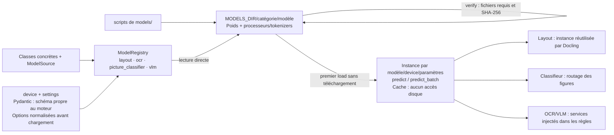
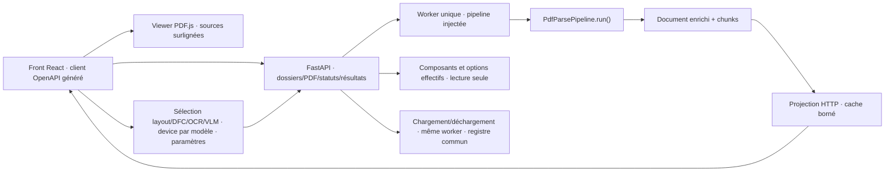

# PdfParsePipeline : composants et flux

Le suivi d'exécution est séparé des données documentaires : `progress.py`
émet les étapes dans une portée de callback ; le backend les projette en jobs
HTTP bornés, affichés par le client OpenAPI. Aucun champ de progression ni
modèle runtime n'est ajouté aux wrappers ou aux chunks persistés.

```mermaid
flowchart TB
    CONFIG["PdfParseConfiguration : Pydantic BaseModel<br/>Types validés · champs figés · extras refusés"]
    PIPE["PdfParsePipeline.run(path)<br/>Unique orchestrateur"]
    PDF["PDF source"]
    LAYOUT["layout : BaseLayoutModel | None<br/>get_options() → options Docling<br/>None → Heron natif"]
    EXTRACT["BasePdfExtractor.extract(path)<br/>DoclingPdfExtractor : StandardPdfPipeline<br/>OCR désactivé · crops activés"]
    DOC["DoclingDocument<br/>Nœuds, relations, pages, géométries, crops"]
    VISIT["enrich_document(path, source)<br/>wrap_document : un parcours body + furniture"]
    ORDINARY["enrich : BaseEnrichModel<br/>NodeItem hors PictureItem → EnrichedElement<br/>HandlerEnrichModel : handlers par type"]
    PICTURES["picture_enrich : BasePictureEnrichModel<br/>PictureItem → EnrichedPictureItem"]
    NATIVE["Défaut : WrappingPictureEnrichModel<br/>Conservation des données natives"]
    CLASSIFIER["PictureEnrichModel configuré<br/>DocumentClassifierModel.predict(crop)<br/>→ PictureClassification"]
    ROUTES["Catégorie native → BasePictureEnricher<br/>enrich(crop, classification, source_text=...) → PictureEnrichment<br/>Texte source réutilisé · OCR seulement si absent"]
    MISSING["Route absente : ERROR ou KEEP explicite"]
    ASSETS["AssetStore injecté<br/>Mémoire ou disque · locator dans le wrapper"]
    ENRICHED["EnrichedDoclingDocument = EnrichedDocument<br/>SHA-256 PDF · relations · légendes · localisations<br/>Figures : modèle, scores, route, version, OCR<br/>Validation du graphe une fois en sortie"]
    CHUNKING["chunk_document(document)<br/>chunking : BaseChunkingModel.chunk(document)"]
    CHONKIE["ChonkieChunkingModel<br/>Légendes regroupées · un appel au backend<br/>Offsets exacts · contexte des sections"]
    OUT["PdfParseResult(document, chunks)<br/>Chunks : identité source, texte, références,<br/>géométries, contexte, ID unique et transformation_id"]
    JSON["pipeline.codec<br/>WrapperRegistry + EnrichedDocumentCodec<br/>JSON versionné sans dépendance runtime"]

    CONFIG --> PIPE
    CONFIG -. injecte .-> LAYOUT
    TEXTOCR["text_ocr : BaseOcrModel | None<br/>Crops textuels sans texte natif<br/>Avant assemblage · OCR global désactivé"]
    CONFIG -. injecte .-> TEXTOCR
    TEXTOCR -. cellules OCR et bbox .-> EXTRACT
    CONFIG -. injecte .-> ORDINARY
    CONFIG -. injecte .-> PICTURES
    CONFIG -. injecte .-> CHUNKING
    PDF --> EXTRACT
    PIPE --> EXTRACT
    LAYOUT -. configure .-> EXTRACT
    EXTRACT --> DOC --> VISIT
    VISIT -->|nœud ordinaire| ORDINARY --> ENRICHED
    VISIT -->|image exclusivement| PICTURES
    PICTURES -->|défaut| NATIVE --> ENRICHED
    PICTURES -->|classification configurée| CLASSIFIER --> ROUTES --> ENRICHED
    ROUTES -->|route absente| MISSING
    MISSING -->|KEEP| ENRICHED
    NATIVE -. crop .-> ASSETS
    CLASSIFIER -. même crop .-> ASSETS
    ASSETS -. locator .-> ENRICHED
    ENRICHED --> CHUNKING --> CHONKIE --> OUT
    ENRICHED -. sauvegarde et restauration .-> JSON
```



Le bloc Chonkie est une implémentation remplaçable du contrat de chunking.
`StructuralChunkingModel` peut occuper ce même bloc avec un budget total incluant
le contexte et des unités documentaires. Les deux stratégies partagent les
coordonnées canoniques, la construction des chunks et leurs métadonnées de source.
La pipeline contrôle les chunks retournés : identité, références résolubles,
géométries, IDs uniques et version. Elle ne refait pas la validation du graphe.
Les erreurs se propagent ; aucun traitement sémantique ni fallback implicite.

## Exemple de composition

```python
from chonkie import TokenChunker
from pdfparse import (
    ChonkieChunkingModel, NativeLayoutModel,
    PdfParseConfiguration, PdfParsePipeline,
)
from pdfparse.enrich import FileSystemAssetStore

pipeline = PdfParsePipeline(PdfParseConfiguration(
    layout=NativeLayoutModel("heron_101"),
    chunking=ChonkieChunkingModel(
        TokenChunker(tokenizer="character", chunk_size=1024, chunk_overlap=128),
        transformation_id="projet.character-1024-overlap-128.v1",
    ),
    asset_store=FileSystemAssetStore("assets"),
))
result = pipeline.run("document.pdf")
pipeline.codec.save(result.document, "enriched.json")
```

Le tokenizer `character` compte les caractères, sans téléchargement. Injecter
un tokenizer adapté au modèle cible pour un budget en tokens LLM. Le backend
Chonkie doit conserver le texte et ses offsets exacts. Les chunks peuvent
traverser plusieurs éléments/pages ; leur géométrie conserve les éléments
complets recoupés. La version de transformation reste distincte du SHA-256 PDF.

Les étapes restent disponibles seules : `pipeline.extractor.extract(path)`,
`pipeline.enrich_document(path, source)` et `pipeline.chunk_document(document)`.
La dernière consomme un document enrichi valide. Les handlers conservent les
parents et les enfants dans leur ordre source. Le chargement JSON refuse les
valeurs non persistables et les chemins PDF contradictoires, sans changer la
version du format.

Pour personnaliser les figures, fournir
`PictureEnrichModel(classifier=mon_classifieur, routes=mes_regles)` au champ
`picture_enrich`. Les règles implémentent `BasePictureEnricher`, avec les
services OCR/VLM injectés. Les labels restent natifs au classifieur.
Voir [le guide d’enrichissement](../../../ressources/docs/ENRICHMENT.md).

La configuration valide les instances des contrats avec Pydantic ; elle ne
convertit pas des dictionnaires en modèles d’inférence ni ne charge leurs poids.
Les erreurs sont des `ValidationError` identifiant les champs incompatibles.

## Modèles : registre et poids centralisés



La catégorie VLM propose Qwen3.5 4B/9B, Granite Vision 4.1 4B et PaddleOCR-VL
1.6, tous derrière `BaseVlmModel`, sans sélection implicite. La catégorie OCR
expose MinerU2.5-Pro, GOT-OCR 2.0, PP-OCRv6 Medium Rec (une ligne par crop) et
RapidOCR PP-OCRv4 (multiligne) derrière `BaseOcrModel`. Le device appartient à chaque
instance, indépendamment des autres modèles. Le registre et les classes restent
hors des données persistées. Aucun format de manifeste de poids propre à
PdfParse n'existe : le Hub est l'unique cache disque des modèles téléchargés.
La provenance des modèles chargés conserve source, commit, tailles et SHA-256
dans les résultats de préparation existants, sans créer un second registre.

Les handlers rendent les tableaux par lignes avec en-têtes et les graphes de
formulaire par associations clé-valeur explicites. Les en-têtes et pieds de
page sont conservés, exclus de l’embedding. `pdfparse.form` et
`pdfparse.key_value` sont en version 2 avec migration depuis v1 ; l’enveloppe
du document reste en version 1.

Le wrapper additionnel `pdfparse.page_description` en version 1 contient une
introduction générée par page : `description`, `content_refs`, `model_id`,
`transformation_id` et `source_markdown_hash`. Il conserve une référence stable
`#/page_descriptions/N`, la géométrie de la page et `original_text=""` pour ne
pas présenter la synthèse comme du texte extrait. Les introductions précèdent
les blocs de leur page dans le Markdown et le flux de chunking. Les relations
Docling restent inchangées. Aucun ancien wrapper ne change de schéma ; les
anciens documents se chargent sans migration et une nouvelle analyse produit
les introductions lorsque `page_enrich` est activé.

`Chunk.text` conserve l’extrait exact ; `Chunk.contextualized_text` ajoute
`Chunk.context`, constitué des titres ancêtres communs absents de cet extrait.
Les sources couvrent aussi les titres, les légendes regroupées et les cellules
de formulaire utilisées. Le budget Chonkie porte sur `text`, hors contexte.

Après une recherche externe, `result.source_context(ids, max_characters=12000)`
assemble un `SourceContext` à partir des hits de ce résultat. Les blocs sources
complets et dédupliqués sont préférés ; si leur taille dépasse le budget, les
extraits contextualisés sont conservés. Un budget trop petit pour ces extraits
provoque une erreur. Le résultat porte `document_id`, `text`, `source_refs`,
`locations`, `chunk_ids` et `expanded`. Le budget inclut les séparateurs et
compte les caractères. Ce résultat de calcul n’ajoute aucun champ au JSON
versionné du document ni au contrat HTTP de Studio.

Le résultat expose aussi `quality_report()`, `index_records()` et
`export_jsonl(path)`. Les chunks portent des offsets canoniques optionnels,
`body_refs`, `section_refs`, `split_reason`, `token_count` et `tokenizer_id`.
L’export `pdfparse.index_record` v1 décrit ces champs avec les filtres et les
empreintes ; le format de persistance des wrappers reste inchangé.

## Consultation locale



La frontière HTTP ne change pas le format JSON persistant du document enrichi.
Les contrats FastAPI génèrent le SDK utilisé par tous les appels API du frontend.
`RuntimeConfiguration` décrit les choix locaux de services et `chunking`, une
union discriminée par `kind` : `token`, `sentence` ou `recursive`. Les options
sont strictes et propres à chaque stratégie (taille en caractères,
chevauchement et seuils selon le type). `chunk_size` à la racine est retiré ;
le SDK et les appelants utilisent `chunking.chunk_size`. `RuntimeStatus` distingue chargement,
configuration chargée, déchargement, mode natif et échec ; sa révision invalide
les résultats affichés. `RuntimeOptions` expose le catalogue, la disponibilité
des poids, les schémas de paramètres et les devices présents. Aucun moteur ni
runtime n'est sérialisé. Ces contrats HTTP ne modifient aucun schéma persistant.

## Résultat de préparation avancée

`PdfParseResult` ajoute les preuves d'extraction (régions de layout), leur
indicateur de disponibilité, un manifeste JSON immuable et les mesures
`StageMetrics`. `BasePdfExtractor.extract_with_evidence()` retourne
`ExtractionResult` ; son comportement par défaut appelle une seule fois
`extract()` et indique l'absence de preuves. Docling le spécialise sans
réextraire le PDF. Les wrappers enrichis persistés restent inchangés.

L'export `pdfparse.index_record` v4 conserve les champs v2 `preparation_hash`,
`table_rows`, `table_links` et ajoute `assets_dir`, `visual_assets`,
`page_contexts` et l'origine textuelle `generated`. Les figures sont reliées
par références explicites et ascendance des nœuds, avec leur rôle corps/contexte,
leurs légendes et descriptions. Les synthèses de page restent séparées du texte
à encoder. Migration v1/v2/v3 explicite dans `migrate_index_record`, sans inventer
les métadonnées absentes ni modifier `content_hash`. Voir
[PRERAG.md](../../../ressources/docs/PRERAG.md) pour les limites de mesure et le contexte progressif.


La v4 ajoute le chemin du PDF, les tags des modèles par référence et les IDs
des chunks voisins. L'inventaire `pdfparse.visual_record` v1 est indépendant des
chunks textuels : toutes les figures restent exportables, même sans texte.
`IndexSnapshot` fige simultanément ces deux projections et partage leurs calculs
communs. Aucun runtime ni pixel PIL n'est sérialisé.

Studio expose `Result.assets`, `Result.document_path` et `Item.models`.
`GET /api/documents/{document_id}/assets/{asset_id}` sert le PNG du stockage
ayant produit ce résultat ; l'ID doit appartenir au résultat en cache. Les
URLs ne permettent pas de lire un chemin arbitraire. Les réponses disposent
d'un ETag et acceptent `If-None-Match` ; les images sont chargées à la demande.

## Enveloppes du cache adjacent

Le format `pdfparse.result_cache`, version 2, utilise `manifest.json` :
`configuration_hash`, `configuration`, `pdf_sha256`, `pdfpath`, `files`
(mapping métadonnée relative → SHA-256) et `assets` (locator relatif → SHA-256).
Le dossier est identifié par le SHA-256 du contenu PDF et de la configuration.
Les crops sont uniquement sous `assets/` dans cette entrée et disparaissent
avec elle lors d'une purge. La v1 du cache n'est pas restaurée : les sources
sont recalculées explicitement au format courant, sans migration SQL ni
modification du schéma des documents. Le format `pdfparse.chunks`, version 1,
contient `chunks`, sérialisés selon le contrat `Chunk`. Les versions inconnues
sont refusées et entraînent un nouveau calcul. `document.json` conserve le
format versionné du codec existant. `result.json` conserve pages, preuves
d’extraction et métriques ; `preparation.json` conserve le manifeste de
préparation. Aucun modèle, runtime, crop PIL ni PDF original n’est sérialisé.

`models.json`, `quality.json`, `index.jsonl`, `visuals.jsonl` et `document.md`
conservent les projections du résultat initial. `ResultProjection` est un
snapshot explicite de fin de traitement, sans mémoïsation du document mutable.
Ces exports ne constituent pas une publication dans la base RAG.
