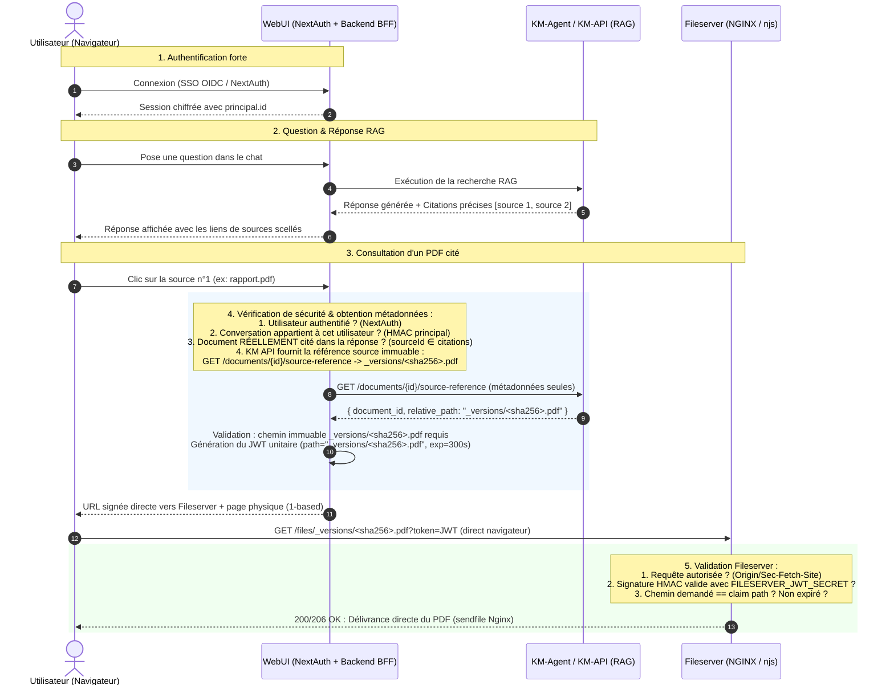
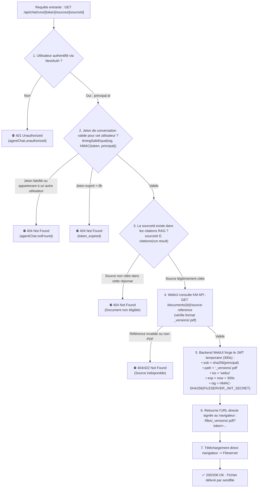

# Architecture de Sécurité de WebUI (`SECURITY.md`)

Ce document formalise les principes d'authentification, le cloisonnement des conversations et la chaîne de confiance régissant la distribution sécurisée des documents du corpus entre **WebUI** et **Fileserver**.

---

## 1. Rôle Pivot de WebUI : Tiers de Confiance Central (BFF)

En environnement de production, **WebUI est l'unique point d'entrée exposé publiquement aux utilisateurs**. Il opère en tant que **Backend-For-Frontend (BFF)** et joue le rôle de garde-barrière (*gatekeeper*) :
* **Authentification centralisée** des utilisateurs via NextAuth / Auth.js (OIDC d'entreprise ou compte administrateur local).
* **Cloisonnement par principal vérifié en tests** des conversations (*runs*) entre utilisateurs par signature cryptographique HMAC.
* **Contrôle d'accès unitaire aux documents** : un utilisateur ne peut **JAMAIS** naviguer librement dans le corpus ni télécharger un document qui n'a pas été **explicitement cité par le RAG** pour répondre à sa question.
* **Seul émetteur habilité** des jetons JWT pour Fileserver (`iss: "webui"`).

---

## 2. Schéma de la Chaîne de Confiance (*Chain of Trust*)

Le cycle de vie complet d'une requête utilisateur, depuis l'authentification jusqu'à la consultation d'un document cité, suit un flux rigoureusement contrôlé :



---

## 3. Matrice de Décision & Contrôle d'Accès aux Documents



---

## 4. Les 4 Piliers de Sécurité Implémentés

### Pilier 1 : Authentification Forte & Gestion des Sessions
* **NextAuth / Auth.js** : Gère l'authentification via un fournisseur OIDC d'entreprise (`WEBUI_AUTH_OIDC_ISSUER`) ou un compte local sécurisé (`WEBUI_AUTH_ADMIN_LOGIN` / `WEBUI_AUTH_ADMIN_PASSWORD`).
* **Secret de Session** : `WEBUI_AUTH_SECRET` (minimum 32 caractères aléatoires requis en production). Tout démarrage avec un secret manquant ou trop court échoue immédiatement (*fail-fast*).
* **Confiance Proxy** : `WEBUI_AUTH_TRUST_HOST=true` autorise Auth.js à faire confiance aux informations d’hôte transmises par le proxy. Le proxy doit lui-même contrôler ces en-têtes ; cette option ne constitue pas un filtre d’hôtes.

### Pilier 2 : Scellement Cryptographique des Conversations
* **Isolation Inter-Utilisateurs** : Chaque identifiant de run est combiné avec l'identifiant utilisateur (`principal.id`) et signé par HMAC-SHA256 :
  ```typescript
  createHmac('sha256', env.WEBUI_AUTH_SECRET)
    .update(JSON.stringify(['webui-athena-v1', env.WEBUI_SESSION_EPOCH ?? '0', principal, payload]))
    .digest('hex');
  ```
* **Protection Temporelle** : La comparaison des signatures est effectuée à temps constant via `timingSafeEqual` pour neutraliser les attaques par canal auxiliaire (*timing attacks*).
* **Durée de Vie Bornée** : Les jetons de conversation expirent automatiquement après 8 heures.

### Pilier 3 : Principe du Moindre Privilège Documentaire & Contrat Source
* **Aucun accès arbitraire** : WebUI ne propose aucune API permettant de parcourir ou d'énumérer le corpus de fichiers bruts.
* **Condition d'éligibilité stricte** : Dans le chat, le document doit figurer parmi les citations du run autorisé. La recherche documentaire possède son propre parcours de références signées, lié aux résultats accessibles à la session. Si un utilisateur manipule l'URL pour demander `sourceId=99` alors que seules 2 sources ont été citées, la requête est rejetée en `404 Not Found`.
* **Zero PDF Bytes Transit** : Dans le parcours WebUI actuel, les octets du PDF ne transitent **pas** par KM-API, WebUI BFF, ou KM-Agent. KM fournit la référence de métadonnées (`_versions/<sha256>.pdf`) et la page physique de preuve ; Fileserver distribue le fichier directement au navigateur.
* **Convention de Page Physique (1-based)** : La page indiquée dans les locators de KM est un numéro de page physique du PDF commençant à 1 (1-based), permettant au composant PDF.js d'ouvrir immédiatement la page exacte sans calcul ou décalage arbitraire.

### Pilier 4 : Signature Cryptographique des Jetons Fileserver
* **Implémentation** : Définie dans `packages/webui/src/backend/source-files/access.ts` et `jwt.ts`.
* **Spécification JWT (RFC 7519, HS256)** :
  ```json
  {
    "sub": "a6c2... (sha256 principal)",
    "path": "_versions/e3b0c44298fc1c149afbf4c8996fb92427ae41e4649b934ca495991b7852b855.pdf",
    "iss": "webui",
    "aud": "fileserver",
    "iat": 1731600000,
    "exp": 1731600300
  }
  ```
* **Durée de validité** : 300 secondes (5 minutes). Renouvelée automatiquement par le client WebUI en cas de requête `Range` tardive.
* **Clé Secrète Partagée** : Signé avec `FILESERVER_JWT_SECRET`, connu exclusivement de WebUI et de Fileserver.

---

## 5. Intégration & Références Croisées

* **Sécurité Fileserver en Production** : Voir [PROD_SECURITY.md](../fileserver/PROD_SECURITY.md) pour les détails sur la désactivation de l'UI explorateur, le rejet `Sec-Fetch-Site: cross-site` et le filtrage d'hôte `files.*`.
* **Guide Global de Déploiement** : Voir [TUTO_DEPLOY.md](../../TUTO_DEPLOY.md) pour les configurations d'environnement `.env.prod`, le cloisonnement multi-réseaux Docker et les NetworkPolicies Kubernetes.
